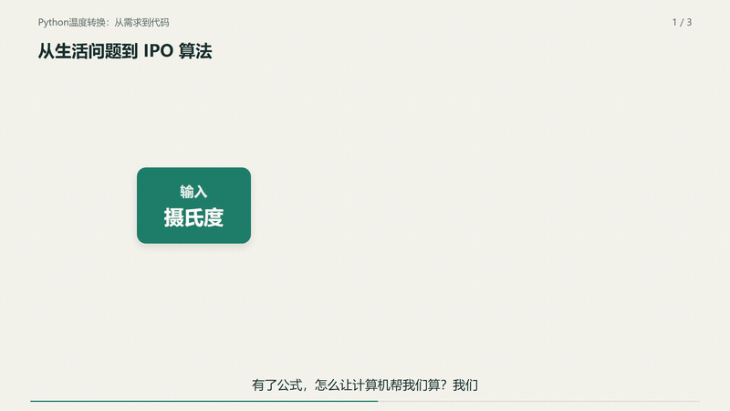
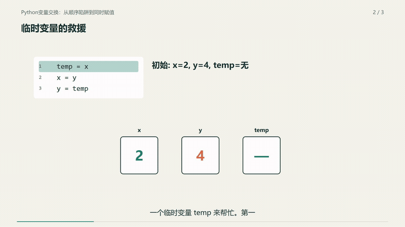

# AI Microlecture Showcase

AI 微课生成平台的成品展示。以下视频由项目实际生成，以教材为参考组织教学内容，并渲染讲解配音、字幕和教学动画。

更新于 **2026-11-23**。点击动图查看完整 MP4；动图为实际成片的无声节选，完整视频包含配音。

## 1. Python 温度转换：从需求到代码

从摄氏度与华氏度的生活问题出发，建立输入—处理—输出（IPO）模型，再将算法写成 Python 程序，通过运行测试理解结果。

**[查看完整视频](./temperature-conversion.mp4)** · [下载 MP4](https://github.com/N0Wei/ai-microlecture-showcase/raw/refs/heads/main/temperature-conversion.mp4)

- 时长：约 **1 分 52 秒**
- 内容：生活问题 → IPO 算法 → Python 代码 → 运行验证

## 2. Python 变量交换：从顺序陷阱到同时赋值

解释顺序赋值为什么会丢失原值，用临时变量展示保存、覆盖与恢复的过程，再介绍 Python 同时赋值。

**[查看完整视频](./variable-swap.mp4)** · [下载 MP4](https://github.com/N0Wei/ai-microlecture-showcase/raw/refs/heads/main/variable-swap.mp4)

- 时长：约 **1 分 30 秒**
- 内容：顺序赋值的陷阱 → 临时变量 → Python 同时赋值

## 视频规格

- 分辨率：1920 × 1080
- 帧率：30 fps
- 格式：MP4，H.264 视频 / AAC 音频
- 语言：中文讲解与字幕

本仓库仅发布成品视频、预览动图和版本信息，不包含教材 PDF、平台源码、模型凭据或私有配置。视频版本及文件校验值见 [samples.json](./samples.json)。
